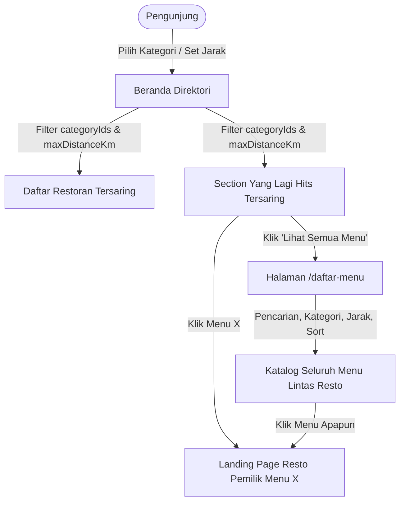

# 📋 Rencana Remake & Ekstensi Direktori Menu: Sinkronisasi Filter & Halaman Semua Menu

Dokumen ini berisi rencana komprehensif dan matang untuk:
1. **Menyinkronkan Filter Kategori & Jarak ke Section Menu Populer ("Yang Lagi Hits")** di halaman beranda direktori.
2. **Membuat Halaman Baru "Lihat Semua Daftar Menu" (`/daftar-menu`)** yang menampilkan seluruh menu makanan dari semua restoran mitra dengan filter jarak & kategori.
3. **Mengatur Interaksi Klik Menu Menuju Landing Page Restoran Pemilik Menu** agar pengguna langsung mengetahui detail restoran penyedia menu tersebut.
4. **Memperbaiki Fallback Foto Menu yang Pecah/Hilang** agar tampilan selalu rapi dan estetik.

---

## 1. Arsitektur & Kebutuhan Fitur

### 🎯 Fitur 1: Sinkronisasi Filter Kategori & Jarak pada Menu Populer di Beranda
Saat ini di `RestaurantDirectory.php`, menu populer diambil secara global (hanya 6 menu acak berfoto).
**Perubahan yang akan diterapkan:**
- Mengaitkan query `popularMenuItems` dengan state filter aktif pada komponen:
  - **Filter Kategori (`categoryIds`)**: Jika pengunjung memilih "Indonesia" atau "Jepang", hanya menu dari restoran yang memiliki kategori tersebut yang ditampilkan.
  - **Filter Lokasi & Jarak (`userLat`, `userLng`, `maxDistanceKm`)**: 
    - Jika lokasi diizinkan, menu diurutkan berdasarkan restoran yang lokasinya paling dekat dengan pengunjung.
    - Jika ada filter radius jarak (misal 5 km), menu dari restoran di luar radius otomatis disembunyikan.
  - **Filter Pencarian (`search`)**: Jika pengunjung mencari "burger" atau "sushi", menu yang relevan otomatis tersaring.
- **Empty State yang Ramah**: Jika kombinasi filter tidak menghasilkan menu, tampilkan pesan informatif: *"Tidak ada menu populer yang cocok dengan filter saat ini. Coba reset filter."* dengan tombol reset instan.

---

### 🌐 Fitur 2: Opsi "Lihat Semua Daftar Menu" (Katalog Menu Global Lintas Restoran)
Di section "Yang Lagi Hits", ditambahkan tombol *"Lihat Semua Menu →"* di header section, serta link *"Menu"* di navigasi header utama.
- **Rute Baru**:
  - URL: `/daftar-menu`
  - Nama Route: `directory.menus`
  - Controller/Livewire: `App\Livewire\Landing\GlobalMenuDirectory`
- **Fitur Halaman `/daftar-menu`**:
  1. **Pencarian Teks Real-Time**: Input pencarian nama makanan, minuman, atau deskripsi menu.
  2. **Filter Kategori Text-Only Pills**: Tombol kapsul teks (*Semua, Indonesia, Kopi & Kafe, Jepang, Cepat Saji, Bar & Lounge*).
  3. **Filter Jarak & Lokasi GPS**: Menggunakan izin lokasi browser yang sama dengan direktori restoran (`setUserLocation`, `maxDistanceKm` 1km, 5km, 10km, dll.).
  4. **Pilihan Urutan (*Sort*)**:
     - *Paling Populer* (Best Seller & Penjualan tertinggi)
     - *Terdekat* (Berdasarkan jarak outlet resto ke pengguna)
     - *Harga Terendah (Termurah)*
     - *Harga Tertinggi (Termahal)*
     - *Terbaru*
  5. **Pagination**: Menampilkan 12–16 item per halaman dengan tombol pagination Livewire yang konsisten.
  6. **Breadcrumb & Header Rapi**: Menjelaskan konteks halaman *"Jelajahi Seluruh Menu Kuliner dari Restoran Mitra"*.

---

### 🔗 Fitur 3: Klik Menu Menuju Landing Page Restoran Pemilik
Sesuai arahan: *"ketika di klik maka akan masuk ke halaman landing page restoran dari pemilik menu tersebut agar user tau detail dari restoran yang punya menu tersebut"*.
- **Desain Interaksi**:
  - Seluruh area kartu menu (gambar foto, judul hidangan, badge diskon, nama resto, dan label harga) dibungkus dalam elemen `<a>` tunggal yang dapat diklik (*Whole-card clickable link*).
  - Tautan mengarah ke: `route('landing.show', $item['restaurant_slug'])` (dengan anchor `#menu`).
  - Efek Hover: Transformasi skala halus pada foto (`group-hover:scale-105`), warna judul berubah ke warna primer (`group-hover:text-primary`), dan kartu terangkat sedikit (`hover:shadow-md`).
- **Informasi yang Didapat Pengguna Saat Membuka Landing Page Resto**:
  - Profil, logo, dan foto cover resto
  - Alamat lengkap, pin peta outlet, dan petunjuk arah
  - Jam buka hari ini (Buka / Tutup)
  - Rating ulasan & review pengunjung
  - Seluruh katalog menu makanan & minuman resto tersebut, lengkap dengan stasiun masak, varian, dan opsi pesan di meja.

---

### 🖼️ Fitur 4: Penanganan Fallback Gambar Menu Pecah/Rusak
Pada screenshot yang Anda bagikan, menu *Sate Ayam* dan *Es Jeruk* mengalami gambar rusak (*broken image 404* dari link eksternal Unsplash).
- **Perbaikan yang Dilakukan**:
  1. **Tag Fallback `onerror`**: 
     Jika gambar gagal dimuat oleh browser, script otomatis mengganti sumber gambar ke placeholder visual makanan yang valid dan menarik.
  2. **Placeholder CSS / SVG yang Menawan**:
     Jika `photo_path` null atau gagal dimuat, tampilkan wadah gradien halus dengan ikon kuliner representatif sehingga kartu tetap terlihat rapi, bersih, dan profesional tanpa teks alt telanjang.
  3. **Pembaruan Link Seeder**:
     Memastikan URL foto pada demo data seeder menggunakan tautan gambar beresolusi tinggi yang terverifikasi aktif.

---

## 2. Struktur Alur Data & Diagram Interaksi



---

## 3. Rincian Teknis Implementasi File per File

### A. Modifikasi `app/Livewire/Landing/RestaurantDirectory.php`
- Perbarui computed property `popularMenuItems`:
  ```php
  #[Computed]
  public function popularMenuItems(): array
  {
      $query = MenuItem::query()
          ->where('menu_items.is_active', true)
          ->whereHas('restaurant', fn ($r) => $r->listedInDirectory());

      // 1. Filter Kategori Restoran
      if (! empty($this->categoryIds)) {
          $query->whereHas('restaurant.categories', fn ($c) => $c->whereIn('restaurant_categories.id', $this->categoryIds));
      }

      // 2. Filter Pencarian
      if (filled($this->search)) {
          $term = '%' . trim($this->search) . '%';
          $query->where(function ($q) use ($term) {
              $q->where('name', 'like', $term)
                ->orWhereHas('restaurant', fn ($r) => $r->where('name', 'like', $term));
          });
      }

      // Eager loading
      $query->with(['restaurant.defaultOutlet', 'restaurant.categories']);

      $items = $query->get();

      // 3. Filter & Sort Jarak jika Lokasi Diizinkan
      if ($this->hasUserLocation()) {
          $items = $items->map(function ($item) {
              $outlet = $item->restaurant?->defaultOutlet;
              if ($outlet && filled($outlet->latitude) && filled($outlet->longitude)) {
                  $item->distance_km = GeoDistance::kilometers(
                      $this->userLat, $this->userLng,
                      (float) $outlet->latitude, (float) $outlet->longitude
                  );
              } else {
                  $item->distance_km = null;
              }
              return $item;
          });

          if ($this->maxDistanceKm !== null) {
              $items = $items->filter(fn ($item) => $item->distance_km !== null && $item->distance_km <= $this->maxDistanceKm);
          }

          $items = $items->sortBy(fn ($item) => $item->distance_km ?? PHP_FLOAT_MAX);
      } else {
          $items = $items->sortByDesc('is_best_seller');
      }

      return $items->take(6)->map(...)->values()->all();
  }
  ```

### B. Komponen Baru: `app/Livewire/Landing/GlobalMenuDirectory.php`
- Komponen Livewire mandiri untuk halaman `/daftar-menu`.
- Memiliki properti:
  - `$search`: Pencarian nama menu / makanan
  - `$categoryIds`: Array ID kategori aktif
  - `$sort`: 'popular' | 'distance' | 'price_asc' | 'price_desc'
  - `$userLat`, `$userLng`, `$locationStatus`, `$maxDistanceKm`: Penanganan geolokasi jarak
- Method:
  - `setCategoryFilter($id)`
  - `setUserLocation(...)`, `disableLocationSearch()`
  - Pagination 12–16 item per halaman.

### C. View Baru & Komponen Blade:
1. `resources/views/livewire/landing/global-menu-directory.blade.php`: Halaman utama katalog menu lintas resto.
2. `resources/views/components/directory/popular-dishes.blade.php`:
   - Tambahkan link *"Lihat Semua Menu →"* ke route `directory.menus`.
   - Bungkus setiap card menu dengan tautan `<a href="{{ $item['landing_url'] }}">` yang membungkus seluruh card.
   - Tambahkan penanganan `onerror` dan fallback visual SVG kuliner hangat untuk foto yang gagal dimuat.
3. `resources/views/components/directory/header.blade.php`:
   - Tambahkan link navigasi *"Menu"* di baris navbar desktop dan mobile.
4. `routes/web.php`:
   - Daftarkan route: `Route::get('/daftar-menu', GlobalMenuDirectory::class)->name('directory.menus');`

---

## 4. Rencana Tahapan Eksekusi (Roadmap)

- [ ] **Fase 1: Sinkronisasi Filter Menu Populer di Beranda** (`RestaurantDirectory.php`)
  - Terapkan penyaringan `categoryIds`, `search`, koordinat `userLat`/`userLng`, dan `maxDistanceKm` pada query `popularMenuItems`.
- [ ] **Fase 2: Perbaikan Tautan Card & Fallback Gambar Menu** (`popular-dishes.blade.php`)
  - Jadikan seluruh area kartu menu dapat diklik menuju landing page resto pemilik menu.
  - Tambahkan penanganan fallback gambar agar tidak ada foto makanan yang pecah/rusak (seperti Sate Ayam & Es Jeruk).
  - Tambahkan tombol link *"Lihat Semua Menu →"* di header section "Yang Lagi Hits".
- [ ] **Fase 3: Pembuatan Halaman Baru Global Menu Directory** (`GlobalMenuDirectory.php` & blade)
  - Daftarkan route `/daftar-menu` di `routes/web.php`.
  - Buat komponen Livewire `GlobalMenuDirectory` dengan pagination, search bar, filter kategori text-only pills, dan filter jarak lokasi terdekat.
  - Buat view `global-menu-directory.blade.php` dengan grid kartu menu yang padat dan responsif.
- [ ] **Fase 4: Navigasi Header & Integrasi Menu Bar**
  - Tambahkan link *"Menu"* di navbar header agar pengunjung dapat mengakses halaman menu dari mana saja.
- [ ] **Fase 5: Validasi, Pengujian Otomatis & Pembaruan Graph**
  - Buat test otomatis untuk filter menu populer dan halaman `/daftar-menu`.
  - Jalankan `php artisan test` untuk memastikan seluruh test suite tetap 100% lulus.
  - Jalankan `npm run build` dan `graphify update .`.
